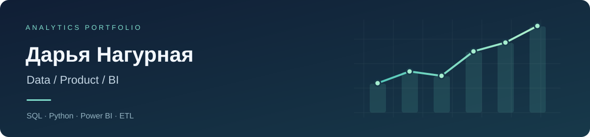

### Data Analyst · Product Analytics · BI

От данных и проверки гипотез — к понятным выводам для бизнеса.

**Москва · Удалённо / гибрид · Открыта к Junior-позициям и стажировкам**

[Проекты](#проекты) · [Стек](#стек) · [GitHub](https://github.com/nagdarnik?tab=repositories)

---

## Обо мне

Работаю с SQL и Python: собираю и очищаю данные, исследую продуктовые метрики и превращаю результаты анализа в отчёты и рекомендации. В проектах использую PostgreSQL, pandas, Excel и Power BI.

Мне интересны продуктовая аналитика, BI и качество данных — задачи, где важно разобраться в поведении пользователей, проверить гипотезу и объяснить результат команде.

## Стек

| Направление | Инструменты и навыки |
| :--- | :--- |
| **Данные и SQL** | PostgreSQL · JOIN · CTE · оконные функции · проектирование БД |
| **Python** | pandas · NumPy · SciPy · statsmodels · Matplotlib · Seaborn |
| **BI и отчётность** | Power BI · DAX · Excel · Power Query · сводные таблицы |
| **Подготовка данных** | ETL · SQLAlchemy · CSV / JSON / XLSX / XML · проверки качества |
| **Продуктовая аналитика** | A/B-тестирование · Retention · DAU / MAU · конверсия · ARPU |

## Проекты

### 01 / [mosmusic_DWH — ETL и SQL-аналитика](https://github.com/nagdarnik/etl-mosmusic-dwh)

**Python · pandas · PostgreSQL · SQLAlchemy**

Пайплайн для объединения данных о клиентах, заказах, товарах, платежах и событиях из пяти файлов в четырёх форматах.

- Загрузка и преобразование CSV, JSON, XLSX и XML.
- Дедупликация, обработка некорректных дат и значений, журнал ошибок.
- SQL-отчёты по выручке, покупателям и заказам.

[Код ETL](https://github.com/nagdarnik/etl-mosmusic-dwh/blob/main/src/etl.py) · [SQL-запросы](https://github.com/nagdarnik/etl-mosmusic-dwh/blob/main/sql/analytics.sql) · [Модель данных](https://github.com/nagdarnik/etl-mosmusic-dwh/blob/main/ddl/create_tables.sql)

### 02 / [PlusAura — здоровье и продуктивность](https://github.com/nagdarnik/PlusAura)

**Продуктовый проект · Flutter · Python / FastAPI · PostgreSQL**

Прототип приложения для отслеживания питания, тренировок и повседневных задач. Проект объединяет пользовательские сценарии, работу с данными и визуализацию прогресса.

- Экраны питания, тренировок, календаря и аналитики.
- Серверные API для пользовательских данных и генерации плана питания.
- Практика проектирования продукта и взаимодействия клиентской части с backend.

[Исходный код](https://github.com/nagdarnik/PlusAura/tree/main/lib) · [Backend](https://github.com/nagdarnik/PlusAura/blob/main/lib/backend/main.py)

### Ещё практика / [Python: четыре задачи по данным](https://github.com/nagdarnik/block2-solutions)

Прогнозирование временного ряда, объединение цепочек идентификаторов, нормализация строк и поиск дубликатов.

---

**Ищу задачи, в которых данные помогают улучшать продукт.**

Data Analyst · Product Analyst · BI Analyst

